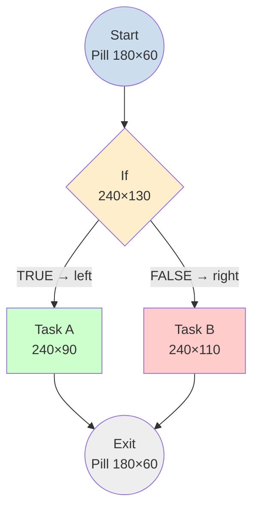

Below is a rewritten, LLM-optimized specification derived from your old rules **and aligned to the actual engine already present in `workflow-ts/designer`** (`Sizes`, `snapToGrid`, `pointToPosition`, `routePoints`, `ConnectorTypes`, `TransitionBranches`, `isIfStep`/`isStartStep`/`isEndStep`). All magic numbers are replaced by named constants that already exist (or are trivially extracted) in the codebase.

---

## Workflow Graph Layout — Deterministic Positioning Rules (LLM spec)

### 0. Conventions (read first)
- Coordinate `x`, `y` is the **top-left corner** of a node, stored as the string `"<x>,<y>"` via `StepUtils.pointToPosition`.
- Every coordinate **must** be snapped to `GRID` using `snapToGrid(x, y, Sizes.DEFAULT_GRID)`.
- A **spine** is a vertical centerline `c`. For any node, `x = c − width/2`. Preserve `c` along a linear chain.
- Layout is computed **per `Component`**. The root of a component is its `start` step (a step with `purpose: START`). Within-component edges follow `transition.source === step && transition.target.parent === step.parent`.

### 1. Constants (anchor to existing engine)
```
GRID              = Sizes.DEFAULT_GRID            // 10   (shared/constants/diagram.ts)
V_GAP             = Sizes.DROP_TARGET_OFFSET      // 50   (shared/constants/diagram.ts)
STEP_W            = STEP_CARD_WIDTH               // 240  (assets/themes/DefaultTheme.ts)
STEP_W_PILL       = 180                           // extract from diagram/DiagramStep.tsx:191
H_PILL            = 60    // Start, Exit
H_IF              = 130   // If
H_FORM            = 180   // Display Form
H_SHORT           = 90    // other activity, description length ≤ 40
H_DEFAULT         = 110   // other activity, description length 40–70 (use if unknown)
H_TALL            = 120   // other activity, description length 70–100
BRANCH_GAP        = 40    // horizontal gap added between an If and its branch centers
```

### 2. Node size (only geometry input)
```
width(step)  = isStartStep(step) || isEndStep(step) ? STEP_W_PILL : STEP_W
height(step) = isStartStep(step) || isEndStep(step) ? H_PILL
             : isIfStep(step)                        ? H_IF
             : isDisplayForm(step)                  ? H_FORM
             : descLen ≤ 40                         ? H_SHORT
             : descLen ≤ 70                         ? H_DEFAULT
             : descLen ≤ 100                        ? H_TALL
             : H_DEFAULT
```
`descLen` = length of `step.description` (or `step.title` if no description). Height depends **only** on type/description, never on input count.

### 3. Vertical assignment (Y / layering)
Process steps in topological order (longest-path ranking) starting at the component root:
```
y(root) = snap(root top = 0)              // or canvas top padding
y(child) = snap( y(parent) + height(parent) + V_GAP )
```
For a node with **multiple parents** (branch merge / join): `y = snap( max(y(parents)) + height(parent_with_max_y) + V_GAP )`.

### 4. Horizontal assignment (X / spine)
Maintain a current spine center `c` per branch.

**4a. Linear chain (no branch):** keep the same spine.
- Same width as predecessor → same `x`.
- Width change (Pill ↔ Standard) → preserve center:
  `x_child = snap( x_parent + (width_parent − width_child) / 2 )`
  (i.e. `c` stays constant; only the top-left shifts).

**4b. If-branch:** an `If` has exactly two outgoing branches, identified by `transition.branch`:
- `TRUE`  → place to the **left** of the If.
- `FALSE` → place to the **right** of the If.
- Neither branch sits directly under the If.

Compute using the If center `c_if` and child half-widths (no hardcoded `−80/+280`):
```
offset(child) = (width(If)/2) + BRANCH_GAP + (width(child)/2)
c_TRUE  = c_if − offset(trueChild)
c_FALSE = c_if + offset(falseChild)
x_child = snap( c_child − width(child)/2 )
```
The branch `c_TRUE` / `c_FALSE` becomes the **local spine** for everything downstream in that branch. It is **never reset** to an earlier spine — a nested `If` shifts cumulatively relative to its own (already shifted) `c`.

### 5. Edge / transition rule
- **Within a component, sequential transitions:** leave `position = ""` (empty). The renderer derives orthogonal points via `routePoints()` from the snapped node bounds.
- **If-branch transitions:** set connectors and leave `position = ""`:
  - `TRUE`  → `sourceConnector = ConnectorTypes.LEFT`,  `targetConnector = ConnectorTypes.TOP`
  - `FALSE` → `sourceConnector = ConnectorTypes.RIGHT`, `targetConnector = ConnectorTypes.TOP`
- **Cross-component transitions:** normally require **no** `position` / `sourceConnector` / `targetConnector`. Only add them if a specific port is mandated.

### 6. Determinism (mandatory)
1. Traverse branches in fixed order: `TRUE` before `FALSE`.
2. Resolve ties (same `y`) left-to-right by `x` (mirrors `comparePositions` in `ProgramEditor`/`StepUtils`).
3. Apply `snapToGrid` as the **final** pass on every `x` and `y`.
4. Output is fully reproducible for identical input graphs.

### 7. Reference mapping (rules → engine)
| Rule | Engine symbol |
|---|---|
| snap to 10-grid | `snapToGrid(x, y, Sizes.DEFAULT_GRID)` |
| `"x,y"` string | `StepUtils.pointToPosition` / `positionToPoint` |
| widths 180/240 | `DiagramStep.tsx:191`, `DefaultTheme.STEP_CARD_WIDTH` |
| orthogonal edges | `routePoints()` + `ObstacleMap` (`shared/routing`) |
| branch left/right | `TransitionUtils.isIfTrue/FalseTransition`, `TransitionBranches` |
| node predicates | `isIfStep`, `isStartStep`, `isEndStep` (`StepUtils`) |

---

### Example (same graph as before, now derived, not hardcoded)

- `S` center spine `c=90` (x=0, w=180). `I` keeps `c=90` (x=−30, w=240), `y = snap(0 + 60 + 50) = 110`.
- `TRUE` center = `90 − (120 + 40 + 120) = −190` → x = −310; `FALSE` center = `90 + 280 = 370` → x = 250.
- All `y` advanced by `snap(y + h + 50)`; all transitions left empty (routed by `routePoints`).

This spec removes every magic number, delegates routing to the existing Manhattan engine, and gives an LLM a deterministic, unambiguous procedure for node and edge placement.

Soll ich — außerhalb des Ask-Mode — diese Regeln als `layoutWorkflow(program)`-Funktion umsetzen, die `program.components[].steps`/`transitions` einliest, Regel 1–7 anwendet und die `position`-Felder (unter Wiederverwendung von `snapToGrid`/`pointToPosition`/`routePoints`) zurückschreibt?